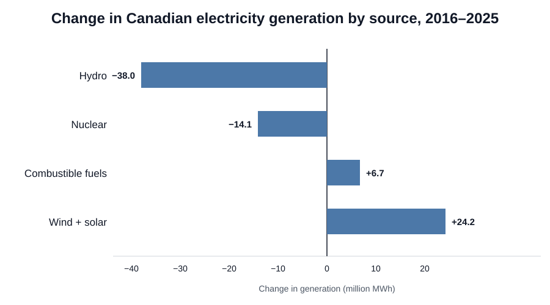
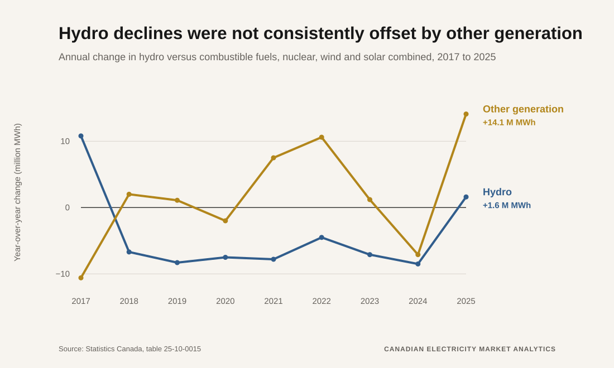
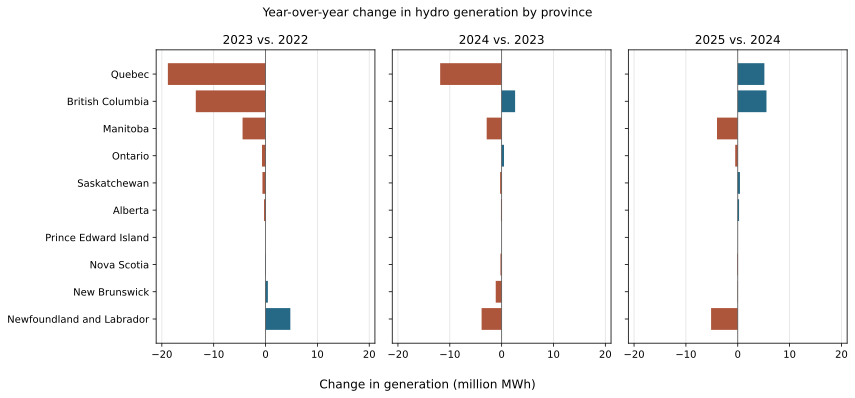

# Canadian Electricity Market Analytics

## Project question

**How is Canada's electricity system changing, and where are the biggest opportunities and challenges in the transition toward cleaner generation?**

## Project purpose

This project analyzes changes in Canada's electricity system using public data, with an emphasis on provincial differences, generation mix, system evolution, electricity trade, and the opportunities and constraints associated with cleaner electricity.

The project is designed as a reproducible analytics case study. Evidence is separated from interpretation, and hypotheses are tested rather than assumed.

## What is implemented

The current pipeline uses Statistics Canada's Web Data Service (WDS) to retrieve and validate monthly provincial electricity data for 2016–2025.

Implemented analysis includes:

- Provincial generation history by hydro, nuclear, wind, solar, and combustible generation
- Annual generation totals and generation-mix shares
- Coverage and StatsCan quality/status-code validation
- 2016 versus 2025 generation change comparisons
- Provincial electricity receipts and deliveries
- Local generation versus electricity available for use
- Net importer/exporter position by province
- A [PEI case study](docs/phase2_pei_wind_and_trade.md) on local wind generation, interprovincial trade, and the Hermanville/Clearspring wind farm

The pipeline preserves source vector IDs, coordinates, status codes, units, and release metadata so results can be traced back to Statistics Canada.

## How provincial electricity trade changed

| Province and period | Change in local generation (million MWh) | Change in net receipts (million MWh) | What drove the change in net receipts |
| --- | ---: | ---: | --- |
| British Columbia, 2022–2023 | −12.7 | +16.6 | Gross receipts rose by 9.4 million MWh and deliveries fell by 7.2 million MWh. |
| Quebec, 2022–2023 | −20.2 | +15.2 | Deliveries fell by 13.2 million MWh, accounting for most of the increase. |
| Quebec, 2023–2024 | −10.1 | +11.2 | Deliveries fell by a further 9.2 million MWh. |
| Prince Edward Island, 2016–2025 | +0.031 | +0.250 | Gross receipts grew faster than deliveries. Net receipts accounted for 89% of the increase in electricity available for use. |

Net receipts equal gross receipts minus deliveries. British Columbia increased incoming electricity and reduced outgoing deliveries during the 2023 hydro shortfall. Quebec's increase in net receipts came mostly from sending less electricity out. Over a longer period, PEI used growing net receipts to meet most of the increase in electricity available for use while local generation also grew. The periods differ because the mainland cases examine annual hydro shortfalls and the PEI case examines a decade-long change in supply.

[British Columbia and Quebec analysis](docs/phase2_trade_corroboration.md) · [Prince Edward Island analysis](docs/phase2_pei_wind_and_trade.md)

## Current Phase 2 visualizations

### Generation change by source, 2016–2025



Hydro and nuclear generation are lower in 2025 than in 2016, while wind and solar show substantial growth. Combustible generation is modestly higher over the same endpoint comparison.

### Annual hydro change versus other generation



The year-over-year comparison tests whether changes in combustible generation, nuclear, and wind/solar collectively offset annual hydro movements. The relationship varies materially by year, so the national data should not be interpreted as a simple one-for-one substitution pattern.

### Provincial hydro generation changes, 2023–2025



Quebec and British Columbia drove most of the combined provincial hydro decline in 2023. Both gained hydro output in 2025, while Manitoba and Newfoundland and Labrador recorded declines.

Regenerate the figure with `python -m src.analyze_generation_transition` from the repository root.

## Working approach

1. Source and assess authoritative Canadian electricity datasets.
2. Define research questions and candidate hypotheses.
3. Build a clean, reproducible analytical dataset.
4. Analyze national and provincial trends.
5. Test explanations for observed changes.
6. Develop clear visualizations and an interactive dashboard.
7. Produce a concise analytical report and portfolio case study.

## Analytical areas

- Electricity generation mix over time
- Provincial differences
- Growth and decline by generation technology
- Interprovincial and international electricity trade
- Reliability, resilience, and system constraints
- Demand growth and electrification
- Transition opportunities and challenges

## Repository structure

```text
canadian-electricity-market-analytics/
├── data/
│   ├── raw/            # Original source files; never manually edited
│   └── processed/      # Cleaned analytical datasets
├── notebooks/          # Exploratory analysis and validation
├── src/                # Reusable Python data and analysis code
├── dashboard/          # Dashboard application and assets
├── report/             # Final analytical report materials
├── docs/               # Research notes, data dictionary, methodology
├── requirements.txt
└── README.md
```

## Data principles

- Prefer primary sources such as Statistics Canada, the Canada Energy Regulator, Environment and Climate Change Canada, Natural Resources Canada, provincial system operators, and utilities.
- Keep raw data unchanged and document transformations.
- Record source URLs, table identifiers, release dates, and known limitations.
- Distinguish observed results from interpretation.
- Follow the evidence even when results complicate the initial hypothesis.

## Current status

**Phase 2: provincial generation and electricity-trade baseline.**

The project now has a reproducible 2016–2025 provincial generation panel and a companion receipts/deliveries panel. Current work is consolidating these datasets into province-level system profiles and testing which observed patterns represent structural transitions, temporary conditions, or trade-supported supply differences.

Next milestones are annual trajectory analysis, targeted hypothesis testing, visualizations, and a portfolio-facing analytical summary/dashboard.
